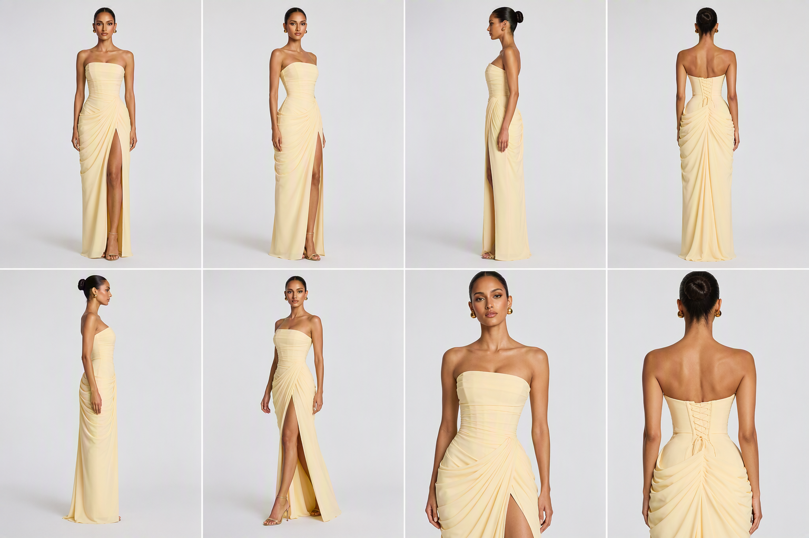

# Bloom

视觉与创意向的服装 AI。给它衣服和趋势，它交回一件新款。

本地打开后，首页就是两间工作室。成品进同一间库，方便对照来源和结果。

| 工作室 | 你给它什么 | 它交回什么 |
| --- | --- | --- |
| [双爆款合成](docs/01-dual-fusion.md) | 两件正在卖得好的衣服，以及各自要留下的设计点 | 一件把两边特点收成一体的新样式 |
| [趋势改造](docs/02-trend-redesign.md) | 一件参考衣服，加上当季结构 / 面料 / 图案趋势 | 一件被趋势改过的新款 |

## 1. 双爆款合成

两件爆款并排。左边一件，右边一件。同一维度只留一个设计点（廓形、领型、面料、细节不能两边各抢一次），然后生成新衣服。

```text
选两件爆款 → 勾选要保留的设计点 → 生成新款 → 成品库
```

页面：`/gap-fusion.html`  
代码：`app/static/gap-fusion.html` · `app/routers/gap_fusion.py` · `app/services/gap_fusion_prompt.py`  
出图工作流：`workflows/product_design_v13.json`



## 2. 趋势改造

先定季节和品类，再勾当季趋势芯片，放进一件要改的衣服。提示词可以手改，然后生成新款。

```text
定季节与品类 → 勾选趋势 → 放入参考衣服 → 生成新款 → 成品库
```

页面：`/design.html`  
代码：`app/static/design.html` · `app/routers/design.py` · `app/services/design_service.py`  
趋势包：`data/nybfw_packs/`  
出图工作流：`workflows/fashion_design_api.json`

## 项目结构

```text
app/static/studio.html          作品首页，两间工作室的入口
app/static/gap-fusion.html      双爆款合成
app/static/design.html          趋势改造
app/static/library.html         成品库
app/routers/gap_fusion.py       合成接口
app/routers/design.py           趋势开款接口
app/services/synthesis_service.py
app/services/comfy_client.py    把密钥从环境变量注入工作流，不写进 JSON
workflows/                      出图工作流（仓库内不含密钥）
data/weekly_gaps/               合成用的演示爆点
data/crawler_feeds/             演示用的外部爆款
data/nybfw_packs/               趋势改造用的季节包
data/gallery/                   已生成样例的索引
docs/                           两件能力与模块地图
```

模块怎么串起来，见 [docs/architecture.md](docs/architecture.md)。

## 本地运行

```bash
python3 -m venv .venv
source .venv/bin/activate
pip install -r requirements.txt
cp .env.example .env
uvicorn app.main:app --host 127.0.0.1 --port 8000
```

或：

```bash
./scripts/start-local.sh
```

打开 <http://127.0.0.1:8000/>。

没有推理服务时，两间工作室的选款、趋势和提示词仍然可以走通。真出图需要在本机 `.env` 打开 GPU 开关，并填入你自己的推理地址和密钥。仓库里的工作流把这些字段留空，程序启动后从环境变量注入。
